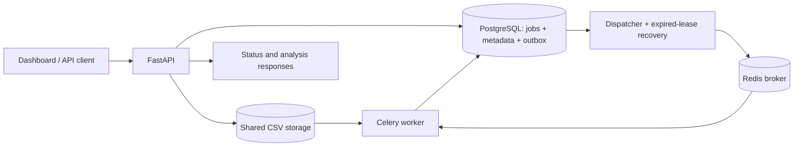

# FlowForge

[](https://github.com/IdoCohen14/FlowForge/actions/workflows/ci.yml)

**A durable background job platform with a complete CSV analysis workflow.** Upload a dataset, follow its job in the dashboard, and retrieve statistics through a documented API. PostgreSQL owns job state; Redis and Celery deliver and execute work. This is a production-style engineering portfolio project for local deployment, with explicit failure semantics and limitations.

## What it demonstrates

- **Transactional outbox:** creating a job and scheduling its publication commit together. The API never needs to coordinate a PostgreSQL commit with a Redis publish.
- **Concurrent processing:** PostgreSQL row locks claim jobs; `SKIP LOCKED` lets dispatchers and recovery processes share work.
- **Crash recovery:** five-minute worker leases, bounded attempts, and claim tokens protect completion from stale workers.
- **CSV analysis:** streaming validation, missing-value counts, and Decimal numeric statistics, stored atomically with completion.
- **A complete interface:** a responsive dashboard, OpenAPI documentation, health check, automated migrations, container startup, tests, and CI.

Python 3.14 · FastAPI · Pydantic · SQLAlchemy 2 · Alembic · PostgreSQL 17 · Redis 7 · Celery 5 · Docker Compose · pytest

## Start the complete application

Prerequisites: Docker Desktop using Linux containers and Docker Compose. From PowerShell in the repository:

```powershell
if (-not (Test-Path .env)) { Copy-Item .env.example .env }
# Choose local credentials in .env before first startup.
docker compose -f compose.yaml -f compose.app.yaml up --build -d --wait
```

Open [the dashboard](http://127.0.0.1:8080/dashboard) and upload `sample_data/sales.csv`. Explore [the API docs](http://127.0.0.1:8080/docs). The welcome endpoint at `/` remains compatible with the original API.

Compose waits for PostgreSQL, runs migrations, and starts the API, worker, and dispatcher. API and worker share an upload volume. The image runs the application as a non-root user. Ports are bound to loopback. Application services restart unless stopped; the migration service exits on success. Existing PostgreSQL and Redis volume names are preserved. If you already have native API or worker processes running, stop them before starting the complete stack to avoid port conflicts or consumers sharing a queue. Starting the dispatcher also processes existing eligible jobs.

```powershell
docker compose -f compose.yaml -f compose.app.yaml ps
docker compose -f compose.yaml -f compose.app.yaml logs --tail 50 api worker dispatcher
docker compose -f compose.yaml -f compose.app.yaml stop
```

Stopping retains data. **Do not use `down --volumes` unless you intend to delete stored data.** Do not replace an existing `.env`; changing its credentials does not update an already initialized PostgreSQL volume. The checked-in password is a local example, never a deployment secret.

## Architecture and delivery guarantees



1. The API validates and stores the upload under a generated filename. Job, CSV metadata, and outbox event commit in one database transaction.
2. The dispatcher claims a bounded batch of due events with `FOR UPDATE SKIP LOCKED`. Publication failures retry exponentially (5 seconds initially, capped at 300 seconds; five attempts). Exhausted events remain in PostgreSQL with `publication_status=failed` for operator investigation.
3. A worker locks a pending job, commits `running`, increments its attempt count, and assigns a random claim token and five-minute lease. Duplicate deliveries of active or terminal jobs return without executing the operation.
4. Processing happens outside the claim transaction. The worker revalidates the CSV and atomically stores results and `completed`, provided its claim token still matches. Processing errors set `failed` and return a generic public error.
5. Each dispatcher poll also recovers expired running jobs in bounded batches. Recovery clears the old claim and creates a new outbox event in the same transaction. After three claimed attempts, expiry sets `failed`. An old worker finishing after recovery cannot overwrite the newer claim or its results. Existing running jobs receive a five-minute grace period during migration.

Delivery is **at least once**, and computation can overlap after lease expiry. Database finalization is fenced; execution is not exactly once. The supplied analysis is read-only and repeatable. Adding external effects such as billing would require a separate idempotency design. Celery late acknowledgement is a supplementary measure; database lease recovery handles interrupted claims even when a duplicate broker delivery was already acknowledged. See [Celery's delivery guidance](https://docs.celeryq.dev/en/stable/userguide/tasks.html) and [Redis transport caveats](https://docs.celeryq.dev/en/stable/getting-started/backends-and-brokers/redis.html).

## API

| Method | Path | Behavior |
| --- | --- | --- |
| GET | `/` | Original welcome JSON |
| GET | `/dashboard` | Workspace totals, drag-and-drop upload, sample data, job search, statistics, quality charts, and JSON export |
| GET | `/dashboard/data` | Paginated dashboard jobs; optional name search, status filter, page and page size (up to 100); global status counts |
| GET | `/samples/sales.csv` | Download the bundled CSV example |
| GET | `/health/ready` | Database connectivity readiness; 503 when unavailable |
| POST | `/jobs` | JSON `{ "name": "Demo" }`; creates a demonstration job and outbox event |
| POST | `/jobs/csv` | Multipart `file`, optional `name`; stores a validated CSV job |
| GET | `/jobs` | Original JSON array of jobs |
| GET | `/jobs/{id}` | Job state; 404 for absent or malformed UUID |
| GET | `/jobs/{id}/analysis` | 202 while pending/running; 200 for completed results or sanitized failure; 409 for demo jobs or missing completed results |
| PATCH | `/jobs/{id}/status` | Legacy demo lifecycle endpoint; 409 for CSV or worker-owned jobs |

Creation retains HTTP 200 and the original `{id, name, status}` response. The worker owns CSV lifecycle transitions. The legacy endpoint permits `pending → running → completed/failed` for unclaimed demo jobs; a manually started demo receives a recovery lease. Terminal states cannot transition again through the API.

```powershell
curl.exe -X POST http://127.0.0.1:8080/jobs/csv -F "file=@sample_data/sales.csv" -F "name=Sales analysis"
Invoke-RestMethod http://127.0.0.1:8080/jobs/JOB-ID/analysis
```

Completed analysis contains `row_count`, `column_count`, `headers`, `missing_values_total`, and `columns`. Each column contains `name`, `missing_values`, and either `numeric: null` or `{count, minimum, maximum, mean}`. Numeric values are strings to avoid JSON float precision loss. `sales.csv` yields **4 rows, 3 columns, no missing values, Price mean 401.25, Quantity mean 5**.

## CSV boundaries and storage

- UTF-8 or UTF-8 BOM, comma separated, one nonempty unique header per column, consistent row widths, and no null characters. Header-only files are valid.
- Up to 10 MiB per file, 256 columns, and 65,536 characters per field. The complete multipart body has an additional 11 MiB ingress cap, including requests without `Content-Length`. Validation rejects excess data while reading.
- Extension must be `.csv`; content is parsed rather than trusted from MIME type. Client filenames never become storage paths. Files receive generated UUID names and are not served publicly.
- Empty or whitespace-only cells count as missing. Numeric statistics require every nonmissing cell in the column to parse as a finite Decimal with adjusted exponent within ±10,000. Other columns have `numeric: null`. Arithmetic uses 50 significant digits; long values and repeating means can be rounded.
- API and worker must use the same absolute `UPLOAD_DIR`. The default native directory is ignored `uploads/`; containers share `uploads_data` at `/app/uploads`. Keep this directory private to the application.
- Failed database inserts remove the newly stored file. Filesystem and database writes are not one transaction: crashes can leave orphan files, and ambiguous commit errors require reconciliation. There is no automatic retention or deletion policy; do not remove referenced uploads while jobs may run.

## Native Windows development

Use the existing `.venv`, or create it and install the declared dependencies:

```powershell
python -m venv .venv
.\.venv\Scripts\python.exe -m pip install -r requirements.txt
docker compose up -d db redis
.\.venv\Scripts\python.exe -m alembic upgrade head
.\.venv\Scripts\python.exe -m alembic check
```

Run these in three terminals:

```powershell
.\.venv\Scripts\python.exe -m uvicorn main:app --reload --port 8080
.\.venv\Scripts\python.exe -m celery -A celery_app:celery_app worker --pool=solo --loglevel=info
.\.venv\Scripts\python.exe -m dispatcher
```

Celery does not officially support Windows. The solo worker is a local development convenience; the Linux container path is preferred. PostgreSQL credentials are loaded from `.env`; environment variables take precedence. Dependencies have bounded versions; transitive dependencies are not locked.

## Verification and reproducible demo

PostgreSQL must be running and the configured role must be allowed to create databases. Tests create uniquely named databases, apply migrations, and remove only those databases. Upload tests use temporary directories. Unit and API tests never publish to Redis or start workers.

```powershell
.\.venv\Scripts\python.exe -m pytest -q
# Run against an already running complete application; creates one sample job:
.\.venv\Scripts\python.exe scripts/demo.py
# Starts isolated real API, dispatcher and worker processes, using running PostgreSQL/Redis:
.\.venv\Scripts\python.exe scripts/verify_pipeline.py
```

The pipeline verifier creates a generated database, temporary upload directory, and unique Redis key/queue prefix. It checks migrations and schema consistency, uploads the real sample over HTTP, waits for actual background completion, checks statistics, delivers a duplicate task, and forcibly stops a claimed worker to verify recovery. The harness advances only its isolated job’s lease to avoid a five-minute wait. Cleanup removes only its own resources. No development jobs or queues are consumed. CI runs the test suite and this real integration check against PostgreSQL and Redis services.

If old Windows temporary directories are owned by a different account, give pytest a **new** writable `--basetemp` path and optionally `-p no:cacheprovider`. Pytest may remove the contents of its selected base directory, so never point it at existing data. A Starlette TestClient HTTPX deprecation warning is currently expected.

## Benchmark

```powershell
.\.venv\Scripts\python.exe scripts/benchmark.py --rows 100000 --runs 3
```

Generates a deterministic three-column CSV in temporary storage, verifies its row count, and prints timings, median rows/second, input bytes, Python version, and platform. This measures the analyzer only, including file reads; it excludes upload validation, HTTP, dispatch latency, database writes, and queue contention. It is not a distributed capacity or latency guarantee. See [verification notes](docs/verification.md) for the measured local run.

## Scope and remaining limitations

This is a single-host portfolio deployment. Before exposing it publicly, add authentication/authorization, TLS, rate limits and quotas, request/concurrency limits, backup/restore procedures, monitoring, and upload retention. There is no tenant isolation; clients can list all jobs. The original unpaginated job list is retained for compatibility. The dashboard uses a separate paginated endpoint, ordered by the earliest outbox event timestamp (historical jobs without events appear last). Searches are case-insensitive literal substrings of job names, combined with the selected status filter. Status totals cover the full workspace, independent of filters. Responses are bounded; aggregate counts and submission-time sorting still scan database records and will need indexing or a dedicated job timestamp at larger scale.

Worker leases are fixed, without heartbeat renewal or forced cancellation. An analysis that exceeds five minutes may be recomputed and eventually fail after three attempts. Scale or renew leases before supporting longer operations. Processing validation failures are terminal, while interrupted claims retry. Permanent broker publication failures stay in the outbox for manual remediation; pending jobs are not automatically failed. Redis loss after successful publication can strand a pending job, since the outbox's published marker is not automatically reconciled. A running dispatcher is required for recovery.

The readiness check verifies PostgreSQL connectivity, not schema version, broker health, or worker progress. There is no distributed tracing or operator retry UI. Redis AOF uses one-second syncing and is not a zero-loss transport; back up PostgreSQL and upload storage together. No exactly-once or high-availability claim is made.

## Repository map

`main.py` API · `models.py` persistence · `tasks.py` claims and execution · `dispatcher.py` publication/retries · `recovery.py` expired claims · `file_storage.py` secure storage · `csv_analysis.py` streaming statistics · `migrations/` schema · `static/` dashboard · `tests/` regression coverage · `scripts/` demo and verification · `.github/workflows/ci.yml` automation
